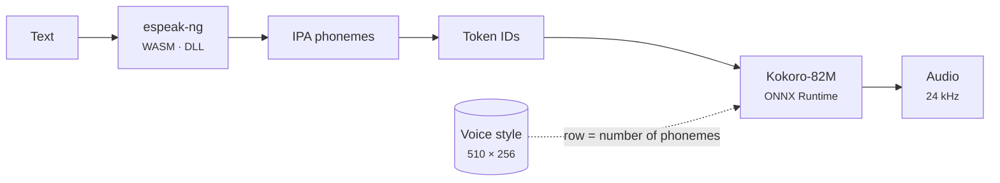

# PopSay 🔊

**English** · [Español](README.es.md)

Select any English text and a **floating bubble pronounces it**, with IPA transcription, syllable-by-syllable highlighting, American or British accent, speed control and loop playback.

https://github.com/user-attachments/assets/f5d2dcbc-3c24-4547-92e5-b4ae764d36b0

📦 **[Download](https://github.com/DanielP41/PopSay---Phonetics-in-speech-bubbles/releases)** the portable Windows app or the browser extension

**Built with:** Python 3.12 · PySide6 (Qt) · Kokoro-82M · ONNX Runtime · CMUdict · espeak-ng · Pyphen · JavaScript · WebAssembly · FastAPI (optional) · C + Zig (launcher)

**It works offline and it is portable.** The neural voice ([Kokoro-82M](https://huggingface.co/hexgrad/Kokoro-82M), Apache 2.0), the phonemizer (espeak-ng) and the IPA dictionary (CMUdict, ~126,000 words) ship inside the program. No text ever leaves your computer.

> The app's interface is in Spanish: it was built for Spanish speakers who are learning English.

There are two ways to use it, and both share the same core:

| | Portable Windows app | Chrome / Edge extension |
|---|---|---|
| Where it works | In **any program**: Word, PDF readers, Telegram, browsers… | Inside the browser |
| Installation | None: unzip and open `PopSay.exe` (runs from a USB drive) | Load the folder or the zip |
| How to trigger it | `Alt+Shift+P` on a selection, or the small blue icon that appears when you select with the mouse | Select text, press `Alt+Shift+P`, or right-click › *Pronunciar* |
| Engine | Kokoro fp32 on ONNX Runtime (native CPU) | Kokoro int8 on ONNX Runtime Web (multithreaded WebAssembly) |
| Highlighting | Word + syllable, in text and IPA | Word + syllable, in text and IPA |
| Size | ~385 MB zipped | ~73 MB |

```
popsay/
├── core/              # shared core (generated by tools/build_core.py)
│   ├── models/        #   Kokoro fp32 (325 MB, desktop) and int8 (92 MB, extension) + vocabulary
│   ├── voices/        #   8 English voices: 4 American and 4 British
│   ├── ipa/           #   US/UK IPA dictionary with pronunciation variants (5 MB)
│   └── tests/         #   real IPA cases shared by the Python and JavaScript tests
├── desktop/           # portable Windows app (Python + Qt)
│   ├── popsay/        #   app, engine, IPA, Windows integration (ctypes), self-test
│   ├── launcher/      #   .exe launcher in C (compiled with zig from any OS)
│   └── tests/
├── extension/         # Chrome/Edge, Manifest V3
│   ├── src/engine/    #   Kokoro in JS + Web Worker (WASM)
│   └── test/
├── backend/           # optional: FastAPI for cloud voices (Azure/OpenAI/ElevenLabs)
└── tools/             # build, packaging and end-to-end tests
```

## Using the portable app (Windows)

1. Unzip `PopSay-windows-portable.zip` anywhere.
2. Open `PopSay.exe`. A blue icon appears in the system tray.
3. Select English text in any program and press **Alt+Shift+P**, or click the small icon that appears next to the mouse.

While it plays, the word and the **syllable** being spoken are highlighted, both in the text and in the IPA next to it. Drag the bubble by its header to move it, and drag the dots in its bottom-right corner to resize it; the size is remembered, and a double click restores the automatic size. Right-click the tray icon for accent, voice, speed, theme, "Pronunciar portapapeles" (speak the clipboard), "Escribir un texto…" (type a text) and "Iniciar con Windows" (start with Windows). Settings are saved in `data/settings.json`, next to the program, so they travel with the USB drive. If something fails, `Diagnostico.bat` runs a self-test and shows the error.

**How it reads the selection from another program.** It uses the Windows API through `ctypes`, with no extra dependencies:
- it registers the global shortcut with `RegisterHotKey`;
- it detects drags and double clicks with a low-level mouse hook;
- it simulates Ctrl+C, reads the text and **restores the previous clipboard**.

The bubble windows never take focus (`WS_EX_NOACTIVATE`), so the selection in the original program is not lost. In terminals it does not send Ctrl+C, because there it would interrupt the running program.

## Using the extension

1. `chrome://extensions` or `edge://extensions` → **Developer mode** → **Load unpacked** → the built `extension/` folder (or the unzipped release).
2. Select text on any page.

The first playback takes a few seconds while the model loads. The offscreen document keeps it in memory, so the next ones are immediate, plus a phrase cache. Settings › **Motor** lets you switch to the system voices or to your own backend.

## Building from source

```bash
pip install numpy cmudict kokoro-onnx pydantic-settings fastapi httpx
python tools/build_core.py                     # downloads the model (once) and generates voices + IPA

# extension
cd extension && npm install && npm run build && npm test && cd ..
python tools/build_zip.py                      # dist/popsay-extension-<version>.zip

# portable Windows app (can be built from Linux, macOS or Windows)
pip install ziglang PySide6-Essentials sounddevice
python tools/build_portable_windows.py         # dist/PopSay/ and its .zip
```

`build_portable_windows.py` assembles the folder like this:
- it downloads a standalone Python 3.12 for Windows ([python-build-standalone](https://github.com/astral-sh/python-build-standalone));
- it installs the Windows packages with `pip --platform win_amd64`;
- it strips the unused parts of PySide6 (165 MB less);
- it copies the C++ runtime that ONNX Runtime needs;
- it compiles the `.exe` launcher with `zig cc`.

There are two GitHub Actions workflows. `tests.yml` runs the linter and every test suite on each push. `windows-portable.yml` builds the app on a real Windows runner, runs the self-test with a voice check and, when a `v*` tag is published, uploads both zips to the release.

## Tests

```bash
ruff check .                           # Python linter
cd desktop  && python -m pytest -q     # IPA, syllables, text chunking, settings, shortcuts
cd backend  && python -m pytest -q     # optional API
cd extension && npm test               # text and IPA logic (same cases as Python) + Kokoro JS core
QT_QPA_PLATFORM=offscreen python tools/smoke_desktop.py   # desktop bubble with the real voice
python tools/smoke_e2e.py /path/to/chrome                  # extension with the NETWORK CUT: loads, speaks, IPA
```

## How the engine works



- **Same phonemes in JS and in Python.** The JavaScript phonemizer has a bug: after `en-us` it ignores `en-gb`. That is why British English uses `en`, and a test checks that phonemes and ids match kokoro-onnx.
- **It starts speaking right away, with no gaps.** The text is split into chunks: the first one is short and plays as soon as it is ready. The app measures how long this computer takes to generate one second of audio and sizes every following chunk so that it is ready before the current one ends. Cuts fall at the end of a sentence, at a comma, or before words such as *when*, *because* or *to*.
- **fp32 on the desktop, int8 in the browser.** On a native CPU, ONNX Runtime runs quantized convolutions poorly, and the fp32 model turns out 2.3 times faster. In WebAssembly it is the other way round: int8 is 1.8 times faster. So each version uses its own.
- **Cache.** In memory, and in the desktop app also on disk (`data/cache`, up to 64 MB): what you already heard plays instantly, even after a restart.

Time to first sound in the desktop app, measured on a 2-core CPU (a typical laptop is faster):

| Text | v1.1 (int8, all at once) | v1.2 (fp32 + chunks) | Repeated (disk cache) |
|---|---|---|---|
| One word | 2.3 s | 1.0 s | instant |
| One sentence | 4.4 s | 2.0 s | instant |
| One paragraph | 15.5 s | 1.1 s | instant |

- **Highlighting.** It uses the real audio duration and the number of phonemes in each word.
- **IPA that matches the voice.** The notation comes from CMUdict converted to dictionary-style IPA (/rɪˈkwaɪɚd/); British English is derived by rules (non-rhotic, /əʊ/, /ɒ/, BATH words). When a word has more than one pronunciation (*read*, *live*, *record*, *the*), the bubble shows the one the engine says in that sentence: the words of the text are aligned with the phonemes from espeak-ng, the same phonemizer that feeds the voice, and the closest variant is chosen. Numbers, acronyms and words missing from the dictionary are transcribed with those same phonemes and marked as approximate (≈).

## Optional backend

`backend/` is a FastAPI service with `/tts` (Azure, OpenAI or ElevenLabs, with a Redis cache) and `/ipa`. **You do not need it**: it is only useful if you want cloud voices. See `backend/.env.example`.

## License

PopSay's code is released under the [MIT License](LICENSE). The models and libraries it uses have their own licenses.

## Third-party licenses

Kokoro-82M (Apache 2.0) · ONNX model from thewh1teagle/kokoro-onnx (MIT) · espeak-ng (GPL-3.0) · CMU Pronouncing Dictionary (BSD) · ONNX Runtime (MIT) · Qt for Python / PySide6 (LGPL-3.0) · python-build-standalone (CPython licenses).
