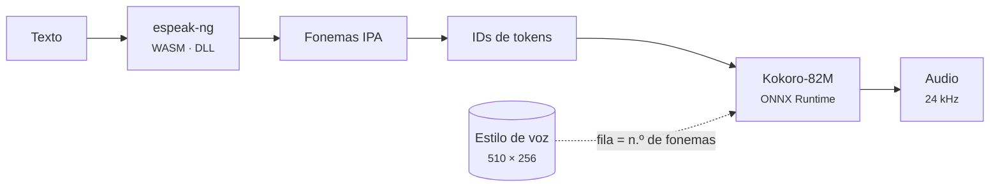

# PopSay 🔊

Seleccionás texto en inglés y aparece una **burbuja flotante que lo pronuncia**, con transcripción IPA, resaltado sílaba por sílaba, acento americano o británico, velocidad y repetición en bucle.

https://github.com/user-attachments/assets/f5d2dcbc-3c24-4547-92e5-b4ae764d36b0

📦 **[Descargar](https://github.com/DanielP41/PopSay---Phonetics-in-speech-bubbles/releases)** la app portable de Windows o la extensión

**Hecho con:** Python 3.12 · PySide6 (Qt) · Kokoro-82M · ONNX Runtime · CMUdict · espeak-ng · Pyphen · JavaScript · WebAssembly · FastAPI (opcional) · C + Zig (lanzador)

**Funciona sin internet y es portable.** La voz neuronal ([Kokoro-82M](https://huggingface.co/hexgrad/Kokoro-82M), Apache 2.0), el fonemizador (espeak-ng) y el diccionario IPA (CMUdict, ~126 mil palabras) viajan dentro del programa.

Hay dos formas de usarla, y las dos comparten el mismo núcleo:

| | App portable de Windows | Extensión de Chrome / Edge |
|---|---|---|
| Dónde funciona | En **cualquier programa**: Word, PDF, Telegram, navegador… | Dentro del navegador |
| Instalación | Ninguna: descomprimís y abrís `PopSay.exe` (sirve desde un pendrive) | Cargar la carpeta o el zip |
| Cómo se activa | `Alt+Shift+P` sobre una selección, o el iconito azul que aparece al seleccionar con el mouse | Al seleccionar texto, con `Alt+Shift+P` o con clic derecho › *Pronunciar* |
| Motor | Kokoro fp32 con ONNX Runtime (CPU, nativo) | Kokoro int8 con ONNX Runtime Web (WebAssembly, multihilo) |
| Tamaño | ~370 MB comprimida | ~70 MB |

```
popsay/
├── core/              # núcleo compartido (lo genera tools/build_core.py)
│   ├── models/        #   Kokoro fp32 (325 MB, escritorio) e int8 (92 MB, extensión) + vocabulario
│   ├── voices/        #   8 voces en inglés: 4 de EE. UU. y 4 británicas
│   └── ipa/           #   diccionario IPA US/UK (4.7 MB)
├── desktop/           # app portable de Windows (Python + Qt)
│   ├── popsay/        #   app, motor, IPA, integración con Windows (ctypes), selftest
│   ├── launcher/      #   lanzador .exe en C (se compila con zig desde cualquier SO)
│   └── tests/
├── extension/         # Chrome/Edge, Manifest V3
│   ├── src/engine/    #   Kokoro en JS + Web Worker (WASM)
│   └── test/
├── backend/           # opcional: FastAPI para voces en la nube (Azure/OpenAI/ElevenLabs)
└── tools/             # armado, empaquetado y pruebas E2E
```

## Usar la app portable (Windows)

1. Descomprimí `PopSay-windows-portable.zip` donde quieras.
2. Abrí `PopSay.exe`. Aparece un ícono azul en la bandeja del sistema.
3. Seleccioná texto en inglés en cualquier programa y presioná **Alt+Shift+P** o tocá el iconito que aparece junto al mouse.

Mientras suena, se resalta la palabra y la **sílaba** que se está pronunciando, en el texto y en el IPA a la par (sílabas escritas con Pyphen; las del IPA, por núcleos vocálicos y marcas de acento). La burbuja se mueve arrastrándola de la cabecera y se agranda arrastrando los puntitos de su esquina inferior derecha (como en las ventanas de Windows); el tamaño se recuerda y con doble clic vuelve al automático. Clic derecho en la bandeja: acento, voz, velocidad, tema, "Pronunciar portapapeles", "Escribir un texto…" e "Iniciar con Windows". Los ajustes se guardan en `data/settings.json`, junto al programa, así que viajan con el pendrive. Si algo falla, `Diagnostico.bat` corre un autodiagnóstico y muestra el error. Más detalles en `desktop/LEEME.txt`.

**Cómo lee la selección de otro programa.** Usa la API de Windows por `ctypes`, sin dependencias extra:
- registra el atajo global con `RegisterHotKey`;
- detecta arrastres y dobles clics con un gancho de mouse de bajo nivel;
- simula Ctrl+C, lee el texto y **restaura el portapapeles** que había.

Las ventanas de la burbuja no toman el foco (`WS_EX_NOACTIVATE`), así que la selección del programa original no se pierde. En las terminales no manda Ctrl+C, porque ahí corta el programa en curso.

## Usar la extensión

1. `chrome://extensions` o `edge://extensions` → **Modo de desarrollador** → **Cargar descomprimida** → carpeta `extension/` ya construida (o el zip descomprimido).
2. Seleccioná texto en cualquier página.

La primera reproducción tarda unos segundos mientras se carga el modelo. El documento offscreen lo deja en memoria y las siguientes son inmediatas, más una caché de frases. Ajustes › **Motor** permite cambiar a las voces del sistema o a un backend propio.

## Armar desde el código

```bash
pip install numpy cmudict kokoro-onnx pydantic-settings fastapi httpx
python tools/build_core.py                     # baja el modelo (una vez) y genera voces + IPA

# extensión
cd extension && npm install && npm run build && npm test && cd ..
python tools/build_zip.py                      # dist/popsay-extension-<versión>.zip

# app portable de Windows (se puede armar desde Linux, macOS o Windows)
pip install ziglang PySide6-Essentials sounddevice
python tools/build_portable_windows.py         # dist/PopSay/ y su .zip
```

`build_portable_windows.py` arma la carpeta así:
- baja un Python 3.12 autónomo para Windows ([python-build-standalone](https://github.com/astral-sh/python-build-standalone));
- instala los paquetes de Windows con `pip --platform win_amd64`;
- saca de PySide6 lo que no se usa (165 MB menos);
- copia el runtime de C++ que necesita ONNX Runtime;
- compila el lanzador `.exe` con `zig cc`.

El workflow `.github/workflows/windows-portable.yml` hace lo mismo en un Windows real de GitHub Actions, corre el autodiagnóstico y publica ambos paquetes como artefactos.

## Tests

```bash
cd desktop  && python -m pytest -q     # IPA, ajustes, atajos, coincidencia con el backend
cd backend  && python -m pytest -q     # API opcional
cd extension && npm test               # lógica de texto + núcleo Kokoro JS (fonemas idénticos a Python)
QT_QPA_PLATFORM=offscreen python tools/smoke_desktop.py   # burbuja de escritorio con voz real
python tools/smoke_e2e.py /ruta/a/chrome                   # extensión con la RED CORTADA: carga, suena, IPA
```

## Cómo funciona el motor



- **Mismos fonemas en JS y en Python.** El fonemizador de JavaScript tiene una falla: después de `en-us` ignora `en-gb`. Por eso para el británico se usa `en`, y un test verifica que los fonemas y los ids coincidan con kokoro-onnx.
- **Empieza a sonar enseguida.** El texto se parte en fragmentos: el primero es corto (hasta la primera coma o ~70 caracteres) y suena apenas está listo. Después va de a una oración, que se genera mientras suena la anterior.
- **fp32 en escritorio, int8 en el navegador.** En CPU nativo, ONNX Runtime ejecuta mal las convoluciones cuantizadas, y el modelo fp32 resulta 2,3 veces más rápido. En WebAssembly pasa al revés: int8 es 1,8 veces más rápido. Por eso cada versión usa el suyo.
- **Caché.** En memoria, y en la app de escritorio también en disco (`data/cache`, hasta 64 MB): lo ya escuchado vuelve a sonar al instante, aun después de reiniciar.

Tiempo hasta el primer sonido en la app de escritorio, medido en una CPU de 2 núcleos (una notebook típica es más rápida):

| Texto | v1.1 (int8, todo junto) | v1.2 (fp32 + fragmentos) | Repetido (caché en disco) |
|---|---|---|---|
| Una palabra | 2,3 s | 1,0 s | instantáneo |
| Una frase | 4,4 s | 2,0 s | instantáneo |
| Un párrafo | 15,5 s | 1,1 s | instantáneo |
- **Resaltado.** Usa la duración real del audio y la cantidad de fonemas de cada palabra.
- **IPA.** Sale de CMUdict convertido a IPA de diccionario (/rɪˈkwaɪɚd/). El británico se deriva por reglas: no rótico, /əʊ/, /ɒ/, palabras BATH. Las palabras que no están en el diccionario se resuelven con espeak-ng y se marcan como aproximadas (≈).

## Backend opcional

`backend/` es un servicio FastAPI con `/tts` (Azure, OpenAI o ElevenLabs, con caché en Redis) e `/ipa`. **No hace falta para nada**: sólo sirve si querés voces en la nube. Ver `backend/.env.example`.

## Licencias de terceros

Kokoro-82M (Apache 2.0) · modelo ONNX de thewh1teagle/kokoro-onnx (MIT) · espeak-ng (GPL-3.0) · CMU Pronouncing Dictionary (BSD) · ONNX Runtime (MIT) · Qt for Python / PySide6 (LGPL-3.0) · python-build-standalone (licencias de CPython).
